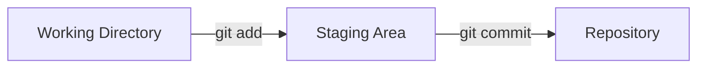
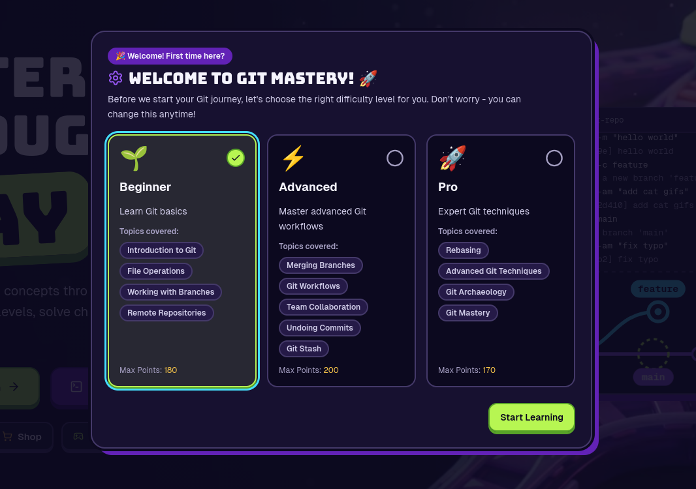
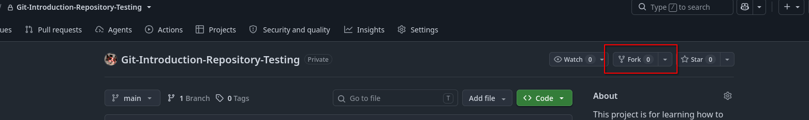
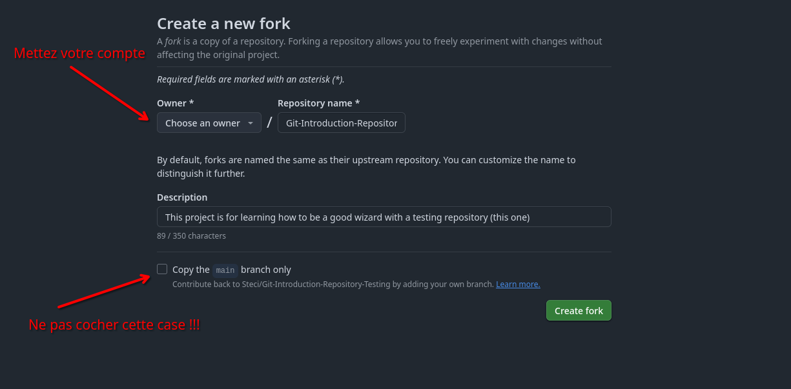

# Atelier Git

Bienvenue dans cette initiation à Git ! :D
Vous allez apprendre à mieux utiliser Git (quelle surprise !)

Point très important à souligner, puisque vous débutez : Git, ce n'est pas uniquement GitHub.
En effet, au cours de votre vie de développeur, vous n'allez pas uniquement utiliser GitHub mais potentiellement GitLab (très utilisé en entreprise), Bitbucket, ou même un serveur Git auto-hébergé.
Les concepts sont les mêmes, ils ont tous Git intégré à leurs outils. GitHub, GitLab, Bitbucket ne sont que des **plateformes** qui hébergent des dépôts Git et ajoutent des fonctionnalités par-dessus (issues, CI/CD, pull requests...). Git, lui, fonctionne exactement pareil partout.

Bref, sans plus attendre, parlons des objectifs du workshop ! Ici, vous apprendrez à :

- Comprendre comment Git fonctionne réellement (et pas juste "par cœur")
- Utiliser des branches
- Fusionner (merge) des branches
- Comprendre la différence entre rebase et merge
- Revenir en arrière sur un commit
- Et plein d'autres techniques !

---

## Partie 1 : La théorie, pour bien comprendre ce qu'on fait

Beaucoup de gens utilisent Git en mode "par recette de cuisine" : ils tapent des commandes qu'on leur a dites sans comprendre ce qui se passe derrière. Ça marche... jusqu'au jour où ça ne marche plus, et là c'est la panique. On va donc prendre 10 minutes pour comprendre les bases, ça vous évitera 90% des galères.

### 1.1 Qu'est-ce que Git, concrètement ?

Git est un **système de contrôle de version décentralisé**. Concrètement, c'est un outil qui prend des "photos" (snapshots) de l'état de votre projet à chaque fois que vous lui demandez (un commit), et qui garde l'historique complet de ces photos.

Contrairement à ce qu'on pourrait croire, Git ne stocke pas des "diffs" (différences) entre chaque version comme le ferait un simple système de sauvegarde de fichiers. Il stocke des **snapshots complets** de l'ensemble de vos fichiers à chaque commit (avec de l'optimisation derrière pour ne pas dupliquer les fichiers identiques).

### 1.2 Les trois zones de Git

C'est LE concept qui débloque tout le reste. Un projet Git a toujours 3 zones :

1. **Working Directory** (répertoire de travail) : vos fichiers tels que vous les voyez et modifiez sur votre disque.
2. **Staging Area / Index** (zone de préparation) : une zone intermédiaire où vous "préparez" les changements que vous voulez inclure dans votre prochain commit. C'est ce que remplit `git add`.
3. **Repository (.git)** : l'historique définitif, là où vivent vos commits. C'est ce que remplit `git commit`.



Comprendre ça explique pourquoi `git add` existe : ça vous permet de choisir précisément quels changements vont dans le commit, même si vous avez modifié 10 fichiers différents.

### 1.3 Qu'est-ce qu'un commit ?

Un commit est une photo de votre projet à un instant T, accompagnée de :
- Un identifiant unique (un hash SHA-1, souvent affiché en version courte, par exemple `a3f9c21`)
- Un message décrivant le changement
- Un auteur et une date
- Une référence vers le(s) commit(s) parent(s)

C'est ce dernier point qui est essentiel : chaque commit pointe vers son commit précédent, ce qui forme une **chaîne**. C'est cette chaîne qui constitue l'historique de votre projet, un peu comme une liste chaînée.

### 1.4 Qu'est-ce qu'une branche, réellement ?

Une branche n'est **rien d'autre qu'un pointeur** vers un commit précis. Ce n'est pas une copie de votre projet, ce n'est pas un dossier séparé : c'est littéralement juste une étiquette collée sur un commit.

Quand vous faites un nouveau commit sur une branche, Git déplace simplement le pointeur de cette branche vers le nouveau commit. C'est pour ça que créer une branche est quasi instantané, peu importe la taille du projet.

`HEAD` est un pointeur spécial : c'est celui qui indique "où vous êtes actuellement". La plupart du temps, `HEAD` pointe vers une branche, qui elle-même pointe vers un commit.

La branche par défaut de votre projet sera toujours main.

### 1.5 Pourquoi plusieurs branches ? Et comment les réunir ?

Imaginez que vous travaillez à trois sur le même projet, tous directement sur `main`. Pendant que vous codez une nouvelle fonctionnalité à moitié terminée, votre binôme corrige un bug, et le troisième teste une idée qui ne marchera peut-être jamais. Résultat : le code de `main` est en permanence cassé, chacun écrase ou perturbe le travail des autres, et impossible de savoir quelle version est "celle qui marche".

Les branches règlent ce problème. Le principe :
- `main` contient la version **stable** du projet, celle qui compile et qui fonctionne.
- Pour chaque nouvelle tâche (une fonctionnalité, une correction de bug, une expérimentation), on crée une **branche dédiée** à partir de `main`. (C'est à dire une copy.)
- Sur cette branche, vous pouvez faire autant de commits que vous voulez, casser des choses, recommencer : ça n'impacte **ni `main`, ni les branches des autres**.

```
fix-bug:             F
                    /
main:      A---B---C
                \
feature:         D---E
```

Chacun avance donc de son côté, en parallèle et sans se gêner. Mais une fois la fonctionnalité terminée ou le bug corrigé, il faut bien que ce travail **revienne dans `main`**, sinon il ne sert à rien ! C'est là qu'intervient la **fusion** des branches : on prend les commits d'une branche et on les intègre dans une autre.

Git propose deux façons de faire ça : **`merge`** et **`rebase`**. Le résultat final dans le code est le même (les changements des deux branches sont réunis), mais la façon dont l'historique est construit est différente. C'est justement ce qu'on va voir maintenant.

### 1.6 Merge vs Rebase : la question qui tue

C'est LA question que tout débutant se pose. Les deux servent à faire la même chose : intégrer les changements d'une branche dans une autre. Mais ils le font différemment.

**Merge** crée un nouveau commit ("commit de fusion") qui a deux parents : le dernier commit de chaque branche. L'historique garde donc la trace exacte de ce qui s'est passé, avec ses branches qui se rejoignent visuellement.

```
main:      A---B---C---M
                \     /
feature:         D---E
```

**Rebase** ne crée pas de commit de fusion : il "rejoue" vos commits un par un, par-dessus la branche cible, comme si vous les aviez écrits après. L'historique devient linéaire.

```
Avant :
main:      A---B---C
                \
feature:         D--E

Après un rebase de feature sur main :
main:      A---B---C
                     \
feature:              D'--E'
```

**Quand utiliser quoi ?**
- `merge` : quand vous voulez garder une trace honnête de l'historique (par exemple pour intégrer une feature terminée dans `main`). C'est aussi le choix le plus sûr sur une branche partagée avec d'autres personnes.
- `rebase` : quand vous voulez un historique propre et linéaire, typiquement pour mettre à jour votre branche perso avec les derniers changements de `main` avant de la partager. **Règle d'or : ne jamais rebaser une branche que d'autres personnes utilisent déjà**, car ça réécrit l'historique (chaque commit rejoué a un nouveau hash).

### 1.7 Revenir en arrière : `revert` vs `reset`

Deux commandes qui semblent similaires mais sont très différentes :

- **`git revert <commit>`** : crée un **nouveau commit** qui annule les changements d'un commit précédent. L'historique n'est pas modifié, on ajoute juste une correction. C'est la méthode à privilégier sur une branche partagée (comme `main`), car elle ne réécrit rien.
- **`git reset <commit>`** : déplace le pointeur de la branche vers un commit antérieur, en "oubliant" les commits plus récents (selon le mode : `--soft`, `--mixed`, `--hard`). C'est une réécriture de l'historique, à utiliser uniquement sur des branches locales/perso, jamais sur des branches déjà partagées avec d'autres. Attention : `--hard` supprime aussi vos modifications non commitées !

### 1.8 Ptit bonus : `git stash`, votre meilleur ami

Vous êtes en train de coder, vos changements ne sont pas prêts à être commités, mais vous devez changer de branche en urgence (un collègue vous demande de l'aide, un bug critique à corriger...) ? `git stash` met de côté vos modifications en cours dans une pile temporaire, et remet votre répertoire de travail dans l'état du dernier commit. Vous pouvez ensuite les récupérer plus tard avec `git stash pop`.
Attention ! À utiliser si vous avez bien compris le reste et que vous êtes **à l'aise** avec git !!

### 1.9 Petit lexique utile

| Terme | Définition |
|---|---|
| **Repository (repo)** | Le projet suivi par Git, avec tout son historique |
| **Commit** | Une photo enregistrée de l'état du projet |
| **Branche** | Un pointeur mobile vers un commit |
| **HEAD** | Pointeur indiquant où vous êtes actuellement |
| **Remote** | Une version du dépôt hébergée ailleurs (ex: GitHub) |
| **Push / Pull** | Envoyer vos commits vers le remote / récupérer ceux du remote |
| **Clone** | Copie complète d'un dépôt distant en local |
| **Fork** | Copie d'un dépôt distant vers votre propre compte (concept de plateforme, pas de Git) |
| **Pull Request / Merge Request** | Demande d'intégration de vos changements (concept de plateforme, pas de Git) |
| **Conflit (conflict)** | Quand Git ne sait pas choisir automatiquement entre deux versions différentes d'une même ligne |

---

## Partie 2 : Mise en pratique

Tout va se passer sur ce site afin que vous vous entraîniez !
-> [https://gitmastery.me/](https://gitmastery.me/)

Vous allez en premier lieu faire tous les niveaux de difficulté donnés. Normalement vous connaissez déjà le niveau "Beginner", mais si vous le souhaitez, vous pouvez commencer par celui-là afin d'être sûr d'avoir bien compris les bases.



Si vous avez des questions, demandez à l'intervenant, bien entendu :)

## Partie 3 : Toujours plus loin

Si vous avez tout fini et que vous voulez vous entraîner en situation réelle, vous pouvez forker ce repo.
Cliquez sur ce lien : [Repo pour s'entraîner](https://github.com/Steci/Git-Introduction-Repository-Testing)

Vous allez forker le repo que nous vous avons préparé afin de tester en situation réelle sans abîmer vos repos actuels.

Tout d'abord, cliquez sur le bouton "Fork".




Ensuite, créez le fork en choisissant un "owner" (vous-même : normalement, c'est votre pseudo GitHub avec votre image de profil si vous en avez une).
Attention à bien décocher la dernière case ("Copy the `main` branch only") comme sur l'exemple, sinon vous n'aurez pas toutes les branches nécessaires aux exercices !



Enfin, clonez le fork que vous avez créé sur votre machine : c'est sur lui que vous ferez la suite des exercices !


Dans ce repo, j'ai déjà simulé un espace de travail avec des features à merger, rebaser et même de quoi revert des commits.

**Exercice 1 :**
Regardez les branches de ce repo. J'aimerais trouver la branche qui corrige le bug : actuellement, le projet ne compile pas à cause d'un oubli.

**Exercice 2 :**
Fusionnez la branche qui corrige le bug dans `main` ! Puis pushez `main` sur le repo.

**Exercice 3 :**
Il semble que le fix avait un commit en trop qui ne devrait pas être là, trouvez lequel et revenez en arrière afin que le projet fonctionne.

**Exercice 4 :**
J'ai fait une feature pour avoir des power-ups ! Ajoutez-la à `main` sans abîmer le projet. Le projet doit bien contenir toutes les features.

## Vous avez tout fini et tout compris ?!
Sachez que vous n'avez découvert que 10 % de Git... ! Il y a encore beaucoup à apprendre.

Par exemple, si vous voulez ajouter seulement certaines modifications d'un fichier (une seule fonction par exemple) et pas le fichier entier : `git add -p`, ça vous permet de faire des commits plus précis et logiques sans casser le code.

Et il y a bien d'autres commandes ! À vous de les découvrir :)

Je vous laisse avec ce site : [https://learngitbranching.js.org/](https://learngitbranching.js.org/), qui vous apprendra encore mieux à utiliser les branches Git.
